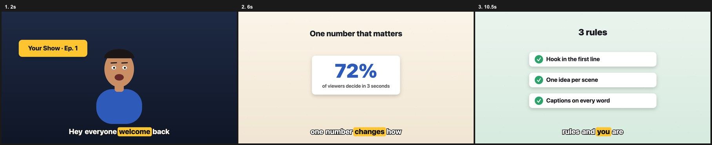

# aansh-video — animated explainer videos with Claude Code

A [Claude Code](https://claude.com/claude-code) skill by **aansh.ai** that turns a voice recording
into an animated, captioned explainer / podcast-style video: a cartoon host with lip-sync,
explainer cards that pop in on the right word, and word-by-word captions — all drawn in code
and rendered to MP4 with [HyperFrames](https://hyperframes.heygen.com).



## Install
```bash
git clone https://github.com/<you>/aansh-video.git
cp -r aansh-video/aansh-video ~/.claude/skills/
```
Then in Claude Code: `/aansh-video make a podcast video from ~/Downloads/voice.mp3, here's the script: …`

## Requirements
- Node 18+ and ffmpeg
- Python 3 with `pip install numpy librosa` (lip-sync)
- `whisper-cli` (`brew install whisper-cpp`) + a ggml model, for word timings

## What's inside
| Path | What |
|---|---|
| `aansh-video/SKILL.md` | The workflow Claude follows |
| `aansh-video/template/` | Starter project: `engine.js` (helpers, simple host, captions, shot runner) + demo `scenes.js` |
| `aansh-video/tools/transcribe.sh` | Audio → word-level whisper JSON |
| `aansh-video/tools/align.py` | Aligns your exact script to whisper timings |
| `aansh-video/tools/mouth.py` | Audio → lip-sync envelope |
| `aansh-video/harness.js` | Runs every frame on a fake canvas to catch crashes before rendering |

Try the demo without any audio:
```bash
cd aansh-video/template && npx --yes hyperframes@0.8.143 preview
```

## Want more?
This is the starter edition. The custom characters, studio sets, icon libraries and multi-language
caption pipeline used in aansh.ai client videos are not included — reach out to aansh.ai for custom work.

## License
MIT for the code in this repo. `template/assets/gsap.min.js` is GSAP, under the
[GreenSock standard license](https://gsap.com/standard-license).
